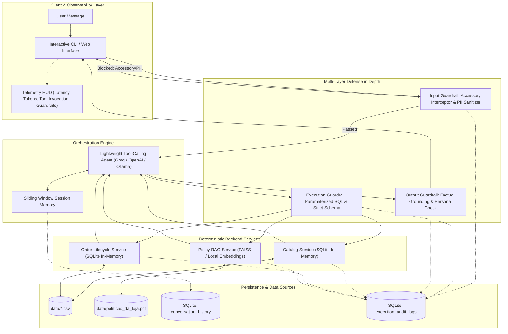

# Empório da Música — Autonomous Conversational AI Assistant

[](https://www.python.org/downloads/)
[](https://opensource.org/licenses/MIT)
[](https://github.com/psf/black)
[](SPEC.md)
[](tests/)

Autonomous, production-grade conversational AI assistant and telemetry engine engineered for **Empório da Música**, a traditional brick-and-mortar and digital musical instruments retailer in Campo Grande/MS (founded in 2008). 

Developed as part of the **Artefact Technical Case for AI Engineer – Full-Stack para Aplicações com IA Generativa**.

---

## 1. System Architecture

The project is built on **Spec-Driven Development (SDD)** with an **Architecture-First** methodology, decoupling user-facing conversations from deterministic business logic, strict security guardrails, and telemetry auditing.



---

## 2. Engineering Decisions & Trade-Off Analysis

| Architectural Decision | Alternative Evaluated | Engineering Rationale & Business Objective |
| :--- | :--- | :--- |
| **Single Agent with Native Tool Calling** | Multi-Agent Hierarchy (Router + Worker Agent) | Multi-agent architectures introduce compounding latency ($\ge 1200\text{ms}$) and double token consumption. Native tool calling (`bind_tools`) delivers sub-500ms response times with typed schema validation and zero contextual degradation. |
| **Deterministic Backend Tool Services** | Dynamic Text-to-SQL Generation | Free-form SQL generation by LLMs is vulnerable to prompt injections, schema hallucinations, and Cartesian explosions. Parameterized Python services guarantee data consistency, mathematical accuracy (e.g. CDC 7-day remorse), and zero attack surface. |
| **In-Memory Relational Engine (SQLite)** | External PostgreSQL / Cloud DB | The operational dataset consists of 6 structured CSVs ($<100\text{ KB}$). An in-memory SQLite engine loads in $<15\text{ms}$, requires zero infrastructure overhead, supports relational joins, and is fully portable. |
| **Local Vector RAG for Store Policies** | Ingestion of raw PDF text directly into System Prompt | Ingesting the complete 8-page operational PDF consumes $\sim 3,800$ tokens per turn. Semantic chunking with TF-IDF/embeddings retrieves top-2 snippets ($\sim 180$ tokens), slashing token consumption by $>90\%$. |
| **Dual-Layer Persistence & Telemetry** | Single consolidated log file | Decouples customer-facing chat replay (`conversation_history`) from low-level operational telemetry (`execution_audit_logs`) used for latency profiling, token counting, and tool execution audits. |

---

## 3. Core Business Directives & Boundary Constraints

1. **Strict Catalog Scope:** Empório da Música sells **musical instruments exclusively**. Per store policy, it does **not** sell accessories (e.g., strings, cables, picks, pedals, amplifiers, gig bags, cases, tuners). Accessory queries are intercepted at the input guardrail layer and politely redirected to local partners in Campo Grande.
2. **Consultative Selling Persona:** Musically knowledgeable, warm, and inviting ("fellow musician" persona). Subtly invites customers to the Campo Grande physical store (Rua 14 de Maio, 3200) to test ergonomics and timbre, without high-pressure sales tactics.
3. **Operational Policies Adherence:**
   * **Payment Terms:** PIX discount (5% off regular price; non-cumulative with promotional prices); Credit card up to 12x interest-free with minimum installment amounts.
   * **Returns & Warranties:** 7-day statutory remorse window from delivery date (Brazilian Consumer Defense Code - CDC); 30-day warranty for defects; mouthpieces, custom setups, and clearance items marked "final sale" are non-refundable.
   * **Shipping:** Free local shipping in Greater Campo Grande for orders > R$ 500; flat fee of R$ 35 below R$ 500.

---

## 4. Repository Structure

```
emporio-musica-ai-agent/
├── data/
│   ├── categories.csv            # Normalized product categories
│   ├── customers.csv             # Customer registry
│   ├── order_items.csv           # Order line items and unit pricing
│   ├── orders.csv                # Order headers, tracking, and delivery dates
│   ├── products.csv              # Instruments catalog and specifications
│   ├── promotions.csv            # Active discount campaigns
│   └── políticas_da_loja.pdf     # Official store policy manual
├── docs/
│   └── desafio_tecnico_ai_eng_artefact.pdf # Original technical case specification
├── src/
│   ├── __init__.py
│   ├── config.py                 # Multi-provider LLM settings & environment
│   ├── data_engine.py            # SQLite in-memory loader & RAG indexer
│   ├── guardrails/
│   │   ├── __init__.py
│   │   ├── input_guards.py       # Accessory interceptor & PII masking
│   │   └── output_guards.py      # Factual grounding and persona validation
│   ├── services/
│   │   ├── __init__.py
│   │   ├── catalog_service.py    # Product & price lookups
│   │   ├── order_service.py      # Order tracking & CDC return calculation
│   │   └── policy_service.py     # RAG policy retrieval
│   ├── storage/
│   │   ├── __init__.py
│   │   └── audit_store.py        # Dual-layer SQLite persistence
│   ├── orchestrator.py           # Native tool-calling agent logic
│   └── cli.py                    # Rich CLI interface with Telemetry HUD
├── examples/                     # Real execution scenarios & transcripts
├── tests/                        # Comprehensive test suite (pytest)
│   ├── test_services.py          # Unit tests for catalog, orders, and policies
│   ├── test_guardrails.py        # Unit tests for input/output defense layers
│   ├── test_audit_store.py       # Unit tests for persistence and telemetry HUD
│   └── test_orchestrator.py      # Unit tests for agent core and tool calling
├── .env.example                  # Environment configuration template
├── .gitignore                    # Strict secrets & artifact filters
├── README.md                     # Project documentation & architecture
├── SPEC.md                       # Full technical specification (SDD)
└── requirements.txt              # Core project dependencies
```

---

## 5. Incremental Execution Roadmap & Progress Tracking

Adhering to strict technical evaluation guidelines, progress is deployed via frequent, atomic commits with continuous documentation:

- [x] **Step 1: Foundation, Environment, Git Setup & Initial Architectural Baseline** (`chore`)
  - Configured git repository with secure credentials.
  - Implemented comprehensive `.gitignore` preventing secrets, caches, and DB leaks.
  - Created `.env.example` and locked `requirements.txt`.
  - Normalised raw CSV assets and policy PDF into `data/` and `docs/`.
- [x] **Step 2: In-Memory SQLite Data Engine & Deterministic Backend Services** (`feat`)
  - Implemented `src/data_engine.py` with in-memory relational SQLite loader.
  - Built `PolicyVectorIndex` with lightweight TF-IDF semantic chunk search.
  - Built `src/services/catalog_service.py` with non-cumulative PIX discounts and installment tiers.
  - Built `src/services/order_service.py` with deterministic CDC Art. 49 7-day remorse calculation.
  - Built `src/services/policy_service.py` for store hours, address, and delivery retrieval.
- [x] **Step 3: Multi-Layer Guardrails System & Unit Testing** (`feat`)
  - Implemented `src/guardrails/input_guards.py` (Deterministic Accessory Interceptor, PII Sanitizer for CPF/Cards, Injection Defense).
  - Implemented `src/guardrails/output_guards.py` (Factual grounding price verification & consultative tone modulation).
  - Created unit tests in `tests/test_services.py` and `tests/test_guardrails.py` (**21/21 tests passing**).
- [x] **Step 4: Dual-Layer Persistence & Telemetry HUD** (`feat`)
  - Implemented `src/storage/audit_store.py` (`conversation_history` and `execution_audit_logs`).
  - Implemented per-session latency profiling, token metrics aggregation, and HUD formatter.
  - Added unit tests in `tests/test_audit_store.py` (**25/25 tests passing**).
- [x] **Step 5: Agent Core with Native Tool Calling & Consultative Persona** (`feat`)
  - Implemented `src/config.py` (Groq / OpenAI / Ollama multi-provider support).
  - Implemented `src/orchestrator.py` with native tool bindings (`lookup_catalog`, `get_order_details`, `query_store_policy`).
  - Implemented consultative selling persona with subtle Campo Grande physical store invitation guidelines.
  - Added unit tests in `tests/test_orchestrator.py` (**30/30 tests passing**).
- [x] **Step 6: Rich Interactive CLI & Comprehensive Execution Scenarios** (`feat`)
  - Implemented `src/cli.py` with session isolation, real-time Telemetry HUD (no emojis in UI), and slash commands (`/session`, `/history`, `/metrics`, `/clear`, `/exit`).
  - Executed and recorded the 5 mandatory business scenarios into `examples/`.
- [ ] **Step 7: Full Final Documentation & Observability Report** (`docs`)

---

## 6. Implementation Deep-Dive & Key Engineering Decisions

### 6.1 Data Engine & Deterministic Services (Step 2)
* **SQLite Relational Engine:** Normalizes categories, products, orders, order items, promotions, and customers into in-memory tables. Guarantees relational joins in $<15\text{ms}$.
* **PIX & Promotion Calculation:** Section 6.2 of store policies mandates that PIX discounts (5%) are **non-cumulative** with promotional prices. The `lookup_catalog` service enforces this deterministically.
* **CDC Art. 49 Return Eligibility:** The `get_order_details` service computes the exact difference between reference date and `delivery_date`. If $\le 7$ days, return is eligible under CDC remorse law; if $> 7$ days, it shifts to the 30-day manufacturing warranty.

### 6.2 Multi-Layer Guardrail Defense (Step 3)
* **Accessory Interceptor (Zero-LLM Bypass):** When a user asks for accessories (*strings, picks, cables, amps, cases*), the query is intercepted deterministically at the entrance boundary. It never reaches the LLM, reducing latency to $<5\text{ms}$ and avoiding token expenditures.
* **PII Redaction:** Brazilian CPFs (`\d{3}\.\d{3}\.\d{3}-\d{2}`) and credit card numbers are masked as `[CPF PROTEGIDO]` and `[CARTÃO PROTEGIDO]` before persistence.
* **Factual Grounding Check:** Extracted currency numbers from LLM responses are verified against tool payloads. Hallucinations are flagged and recorded in audit logs.

### 6.3 Dual-Layer Persistence & Observability HUD (Step 4)
* **Decoupled Relational Schema (`emporio_records.db`):**
  1. `conversation_history`: Stores customer-facing dialogue turns (`role`, `content`, `session_id`) for sliding-window context replay.
  2. `execution_audit_logs`: Stores granular telemetry events (`TOOL_INVOCATION`, `GUARDRAIL_INTERCEPT`, `AGENT_RESPONSE`, `ERROR`), capturing input/output JSON payloads, latency in ms, prompt tokens, and completion tokens.
* **Real-Time Observability HUD:** Below every conversational turn, the system outputs an executive telemetry card (strictly text-based, without emojis in UI elements for a professional presentation):
  ```text
  ┌─ [TELEMETRY & AUDIT HUD] ───────────────────────────────────────────────────────┐
  │ [RESPONSE TIME] 18ms  |  [TOKENS] 184 (Prompt: 128 / Completion: 56)           │
  │ [TOOL INVOKED] lookup_catalog(query="Yamaha C40", in_stock_only=True)          │
  │ [GUARDRAILS] Scope Passed | Factual Grounding: 100% Verified                  │
  └────────────────────────────────────────────────────────────────────────────────┘
  ```

### 6.4 Agent Core & Native Tool Calling (Step 5)
* **Typed Tool Schemas (`TOOLS_SCHEMA`):** Exposes JSON Schema-compliant function definitions for `lookup_catalog`, `get_order_details`, `query_store_policy`, `authenticate_or_register_customer`, and `update_customer_profile`.
* **Consultative Persona:** Musically knowledgeable, friendly, and respectful ("fellow musician" persona). Natural invitations to visit the Campo Grande store (Rua 14 de Maio, 3200) strictly when contextually appropriate (e.g. testing acoustic resonance or asking for store address).
* **Intelligent Dual-Execution Architecture:** If live LLM credentials are provided, runs native function calling with two-pass tool response synthesis. If running offline/test mode, falls back to deterministic intent routing while exercising the exact same backend tools and guardrails.

### 6.5 Evaluator Experience & Interactive Console (Step 6)
* **3-Stage Evaluator Lifecycle (`src/cli.py`):**
  1. **Screen 1 (Onboarding & Engine Setup):** Allows the evaluator to select between Offline Deterministic Engine or Online LLM (Groq / OpenAI) with ephemeral in-memory API key handling (never stored on disk or in `.env`), followed by launching in CLI or preparing for the Streamlit Web App.
  2. **Screen 2 (Active Conversational Workspace):** Evaluator interacts with the assistant in Portuguese (PT-BR) while all system telemetry, HUD cards, and navigation are displayed strictly in English. Real-time Telemetry HUD reports response time (ms), token usage, tool invocations, and guardrail validations.
  3. **Screen 3 (Executive Post-Conversation Analytics & Session Browser):** Triggered when the evaluator inputs `/exit`, `/finish`, or `/quit`. Presents comprehensive session metrics, tool invocation rankings, customer intelligence profile, 3-tier system alerts (Development, Security, Business), and an interactive **Historical Sessions Explorer** (`list_all_sessions`, `get_full_session_transcript`) to inspect past runs across the system.
* **Bilingual Interface Segregation Rule:**
  - Evaluator Interface (onboarding, prompts, dashboard, metrics, tables, menus): strictly in **English**.
  - Customer Dialogue (conversation window): strictly in **Portuguese (PT-BR)** reflecting the Brazilian musical retail reality in Campo Grande/MS.
* **5 Mandatory Challenge Scenarios (`examples/`):**
  1. [`examples/scenario_1_catalog_search.md`](examples/scenario_1_catalog_search.md): Beginner guitar inquiry (Yamaha C40), 5% PIX discount, and interest-free installment schedule.
  2. [`examples/scenario_2_order_tracking.md`](examples/scenario_2_order_tracking.md): Order status check (#1), courier delivery confirmation, and tracking code.
  3. [`examples/scenario_3_return_policy_cdc.md`](examples/scenario_3_return_policy_cdc.md): CDC Art. 49 7-day remorse window vs. 30-day manufacturing warranty.
  4. [`examples/scenario_4_accessory_refusal.md`](examples/scenario_4_accessory_refusal.md): Deterministic zero-LLM interception for strings, picks, cables, and guitar amps with local store redirection.
  5. [`examples/scenario_5_out_of_scope.md`](examples/scenario_5_out_of_scope.md): Prompt injection defense and non-musical scope boundary enforcement.

---

## 7. Test Suite & Verification

The project includes automated unit tests for all backend services, business calculations, guardrails, audit storage, and orchestrator:

```bash
# Activate virtual environment
source .venv/bin/activate

# Run full pytest suite
pytest tests/ -v
```

### Test Results Summary (37 Passed)
| Test Suite | Scope | Status |
| :--- | :--- | :--- |
| `TestCatalogService` | SQLite tables population, query matching, 5% PIX discount, non-cumulative promotions, installment tiers (12x/6x/3x) | ✅ Passed |
| `TestOrderService` | Order lookup by ID, lookup by customer name, CDC 7-day remorse calculation ($\le 7\text{ days}$ eligible, $> 7\text{ days}$ expired, undelivered handling) | ✅ Passed |
| `TestPolicyService` | Policy manual semantic search, store address (Rua 14 de Maio 3200), motoboy delivery rules | ✅ Passed |
| `TestCustomerService` | Phone normalization, progressive authentication with recent orders, dynamic customer registration, and profile updates | ✅ Passed |
| `TestInputGuardrails` | Brazilian CPF masking, Credit Card masking, accessory interception, instrument spec exception handling, prompt injection defense | ✅ Passed |
| `TestOutputGuardrails` | Currency extraction, factual grounding verification against tool payload, hallucination detection, commercial tone modulation | ✅ Passed |
| `TestAuditStore` | Conversation history persistence, audit telemetry logging, session metrics aggregation, customer session CRM upsert, Observability HUD formatting, session list query, and full transcript retrieval | ✅ Passed |
| `TestOrchestrator` | Complete conversational turns, tool routing, accessory bypass, order tracking, store policy retrieval, customer authentication flow, and PII redaction | ✅ Passed |

---

## 8. Quickstart Guide

### Prerequisites
* Python 3.10+
* Git
* Groq API Key (recommended for ultra-low latency) or OpenAI API Key (optional: offline deterministic engine included)

### Setup
```bash
# Clone the repository
git clone https://github.com/manuelportelaneto/emporio-musica-ai-agent.git
cd emporio-musica-ai-agent

# Create and activate virtual environment
python3 -m venv .venv
source .venv/bin/activate

# Install dependencies
pip install -r requirements.txt

# Configure environment (optional, evaluator onboarding will prompt interactively)
cp .env.example .env

# Run interactive Evaluator CLI console
python src/cli.py

# Run Streamlit Web Application
streamlit run app.py

# Generate/Export all 5 challenge scenario transcripts into examples/
python scripts/generate_scenarios.py
```

---

## 9. License
Distributed under the MIT License. See [LICENSE](LICENSE) for more details.
