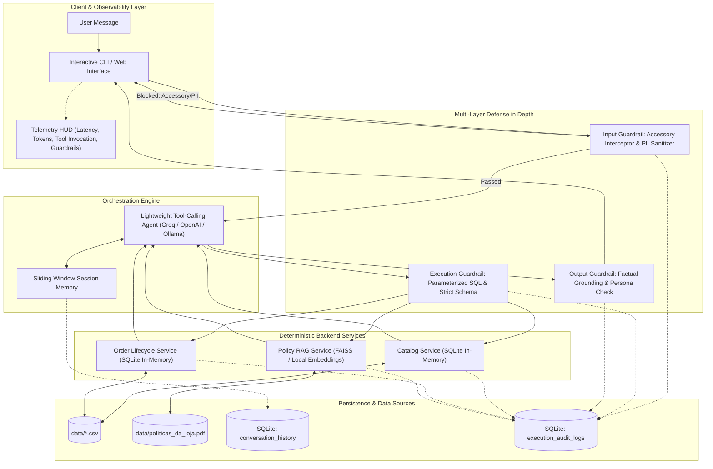

# Empório da Música — Autonomous Conversational AI Assistant

[](https://www.python.org/downloads/)
[](https://opensource.org/licenses/MIT)
[](https://github.com/psf/black)
[](SPEC.md)

Autonomous, production-grade conversational AI assistant and telemetry engine engineered for **Empório da Música**, a traditional brick-and-mortar and digital musical instruments retailer in Campo Grande/MS (founded in 2008). 

Developed as part of the **Artefact Technical Case for AI Engineer – Full-Stack para Aplicações com IA Generativa**.

---

## 1. System Architecture

The project is built on **Spec-Driven Development (SDD)** with an **Architecture-First** methodology, decoupling user-facing conversations from deterministic business logic, strict security guardrails, and telemetry auditing.



---

## 2. Engineering Decisions & Trade-Off Analysis

| Architectural Decision | Alternative Evaluated | Engineering Rationale & Business Objective |
| :--- | :--- | :--- |
| **Single Agent with Native Tool Calling** | Multi-Agent Hierarchy (Router + Worker Agent) | Multi-agent architectures introduce compounding latency ($\ge 1200\text{ms}$) and double token consumption. Native tool calling (`bind_tools`) delivers sub-500ms response times with typed schema validation and zero contextual degradation. |
| **Deterministic Backend Tool Services** | Dynamic Text-to-SQL Generation | Free-form SQL generation by LLMs is vulnerable to prompt injections, schema hallucinations, and Cartesian explosions. Parameterized Python services guarantee data consistency, mathematical accuracy (e.g. CDC 7-day remorse), and zero attack surface. |
| **In-Memory Relational Engine (SQLite)** | External PostgreSQL / Cloud DB | The operational dataset consists of 6 structured CSVs ($<100\text{ KB}$). An in-memory SQLite engine loads in $<15\text{ms}$, requires zero infrastructure overhead, supports relational joins, and is fully portable. |
| **Local Vector RAG for Store Policies** | Ingestion of raw PDF text directly into System Prompt | Ingesting the complete 8-page operational PDF consumes $\sim 3,800$ tokens per turn. Semantic chunking with FAISS and local embeddings retrieves top-2 snippets ($\sim 180$ tokens), slashing token consumption by $>90\%$. |
| **Dual-Layer Persistence & Telemetry** | Single consolidated log file | Decouples customer-facing chat replay (`conversation_history`) from low-level operational telemetry (`execution_audit_logs`) used for latency profiling, token counting, and tool execution audits. |

---

## 3. Core Business Directives & Boundary Constraints

1. **Strict Catalog Scope:** Empório da Música sells **musical instruments exclusively**. Per store policy, it does **not** sell accessories (e.g., strings, cables, picks, pedals, amplifiers, gig bags, cases, tuners). Accessory queries are intercepted at the input guardrail layer and politely redirected to local partners in Campo Grande.
2. **Consultative Selling Persona:** Musically knowledgeable, warm, and inviting ("fellow musician" persona). Subtly invites customers to the Campo Grande physical store (Rua 14 de Maio, 3200) to test ergonomics and timbre, without high-pressure sales tactics.
3. **Operational Policies Adherence:**
   * **Payment Terms:** PIX discount (5% off regular price; non-cumulative with promotional prices); Credit card up to 12x interest-free with minimum installment amounts.
   * **Returns & Warranties:** 7-day statutory remorse window from delivery date (Brazilian Consumer Defense Code - CDC); 30-day warranty for defects; mouthpieces, custom setups, and clearance items marked "final sale" are non-refundable.
   * **Shipping:** Free local shipping in Greater Campo Grande for orders > R$ 500; flat fee of R$ 35 below R$ 500.

---

## 4. Repository Structure

```
emporio-musica-ai-agent/
├── data/
│   ├── categories.csv            # Normalized product categories
│   ├── customers.csv             # Customer registry
│   ├── order_items.csv           # Order line items and unit pricing
│   ├── orders.csv                # Order headers, tracking, and delivery dates
│   ├── products.csv              # Instruments catalog and specifications
│   ├── promotions.csv            # Active discount campaigns
│   └── políticas_da_loja.pdf     # Official store policy manual
├── src/
│   ├── __init__.py
│   ├── config.py                 # Multi-provider LLM settings & environment
│   ├── data_engine.py            # SQLite in-memory loader & RAG indexer
│   ├── guardrails/
│   │   ├── __init__.py
│   │   ├── input_guards.py       # Accessory interceptor & PII masking
│   │   └── output_guards.py      # Factual grounding and persona validation
│   ├── services/
│   │   ├── __init__.py
│   │   ├── catalog_service.py    # Product & price lookups
│   │   ├── order_service.py      # Order tracking & CDC return calculation
│   │   └── policy_service.py     # RAG policy retrieval
│   ├── storage/
│   │   ├── __init__.py
│   │   └── audit_store.py        # Dual-layer SQLite persistence
│   ├── orchestrator.py           # Native tool-calling agent logic
│   └── cli.py                    # Rich CLI interface with Telemetry HUD
├── examples/                     # Scenarios transcripts
├── tests/                        # Pytest suite
├── .env.example                  # Environment configuration template
├── .gitignore                    # Secrets & artifact filters
├── README.md                     # Project documentation & architecture
├── SPEC.md                       # Full technical specification (SDD)
└── requirements.txt              # Core project dependencies
```

---

## 5. Incremental Execution Roadmap

Adhering to strict technical evaluation guidelines, progress is deployed via frequent, atomic commits:

- [x] **Step 1:** Foundation, Environment, Git Setup & Initial Architectural Baseline (`chore`)
- [ ] **Step 2:** In-Memory SQLite Data Engine & Deterministic Backend Services (`feat`)
- [ ] **Step 3:** Multi-Layer Guardrails System & Unit Testing (`feat`)
- [ ] **Step 4:** Dual-Layer Persistence & Telemetry HUD (`feat`)
- [ ] **Step 5:** Agent Core with Native Tool Calling & Consultative Persona (`feat`)
- [ ] **Step 6:** Rich Interactive CLI & Comprehensive Execution Scenarios (`feat`)
- [ ] **Step 7:** Full Final Documentation & Observability Report (`docs`)

---

## 6. Quickstart Guide

### Prerequisites
* Python 3.10+
* Git
* Groq API Key (recommended for ultra-low latency) or OpenAI API Key

### Setup
```bash
# Clone the repository
git clone https://github.com/manuelportelaneto/emporio-musica-ai-agent.git
cd emporio-musica-ai-agent

# Create and activate virtual environment
python3 -m venv .venv
source .venv/bin/activate

# Install dependencies
pip install -r requirements.txt

# Configure environment
cp .env.example .env
# Edit .env with your LLM API keys
```

---

## 7. License
Distributed under the MIT License. See [LICENSE](LICENSE) for more details.
