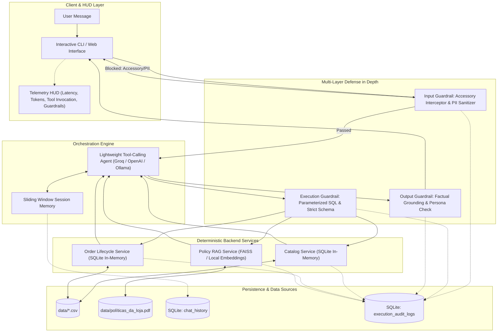

# TECHNICAL SPECIFICATION (SPEC-DRIVEN DEVELOPMENT)
## Autonomous Conversational AI Assistant & Telemetry Engine
**Project:** Empório da Música Conversational Retail Assistant  
**Author:** Manuel Portela Neto  
**Target Position:** AI Engineer – Full-Stack para Aplicações com IA Generativa (Artefact)  
**Target Repository:** `https://github.com/manuelportelaneto/emporio-musica-ai-agent.git`  
**Primary Language:** Python 3.10+  
**Documentation Language:** English  

---

## 1. Executive Summary & Business Scenario

### 1.1 Context
**Empório da Música** is a brick-and-mortar and digital musical instruments retailer founded in 2008 in Campo Grande/MS (Rua 14 de Maio, 3200). Operating for over 15 years, it sells acoustic and electric guitars, basses, drums, keyboards, wind instruments, orchestral strings, and ukuleles. 

The human customer support team is currently bottlenecked by high volumes of repetitive inquiries: store operating hours, live stock status, order tracking, returns, and payment options.

### 1.2 Core Business Directives & Boundary Constraints
1. **Strict Catalog Scope:** The store retails **musical instruments exclusively**. Per internal policy, it does **not** sell accessories (e.g., strings, cables, picks, pedals, amplifiers, gig bags, cases, or tuners). All accessory queries must be politely declined and redirected to partner stores in Campo Grande.
2. **Consultative Selling Tone:** Friendly, warm, musically knowledgeable ("fellow musician" persona), and transparent. The assistant subtly invites local customers to experience instruments in person at the Campo Grande store when evaluating ergonomics or tone, without aggressive or pushy sales tactics.
3. **Operational Policies Adherence:**
   - **Payment:** PIX (5% off on regular-priced items; non-cumulative with active promotions), Credit Card up to 12x interest-free (installments $\ge$ R$ 100 for 7–12x; $\ge$ R$ 80 for 4–6x; $\ge$ R$ 50 for up to 3x).
   - **Returns:** Statutory 7-day remorse return window starting from delivery date (Brazilian Consumer Defense Code - CDC); 30-day warranty for defects; mouthpieces, custom setups, and clearance items marked "final sale" are strictly non-refundable.
   - **Shipping:** Free local shipping in Greater Campo Grande for orders > R$ 500; flat fee of R$ 35 below R$ 500 (motoboy delivery in 1–3 business days). Out-of-state shipments handled via Correios (PAC/SEDEX) and Jadlog.

---

## 2. Engineering Methodology & Architectural Rationale

This project adheres strictly to **Spec-Driven Development (SDD)** with an **Architecture-First** methodology.



### 2.1 Trade-Off Analysis & Architectural Decisions

| Decision | Alternative Evaluated | Engineering Rationale & Business Objective |
| :--- | :--- | :--- |
| **Single Agent with Native Tool Calling** | Multi-Agent Hierarchy (Router + Worker Agent) | Multi-agent pipelines introduce dual LLM invocations for every turn, compounding latency ($+1200\text{ms}$) and doubling token costs. Native function calling (`bind_tools`) achieves deterministic sub-500ms execution with typed JSON schema validation and zero loss of contextual parameters. |
| **Deterministic Backend Tool Services** | Text-to-SQL Dynamic Generation | Free-form SQL generation by LLMs is vulnerable to prompt injection, schema hallucination, and Cartesian product overflows. Encapsulating domain logic into Python services with parameterized queries guarantees data security, token efficiency, and predictable business outputs. |
| **In-Memory Relational Engine (SQLite)** | External PostgreSQL / Cloud DB | The operational dataset consists of 6 structured CSVs ($<100\text{ KB}$). An in-memory SQLite engine (`sqlite3`) loads in $<15\text{ms}$, requires zero infrastructure overhead, provides relational integrity (`JOIN` across products, promotions, and orders), and is fully self-contained. |
| **Decoupled Local Vector RAG for Policies** | Ingestion of raw PDF text directly into System Prompt | Ingesting an 8-page PDF directly into the context window wastes $\sim 3,800$ tokens per conversational turn. Semantic chunking into FAISS with local CPU embeddings (`all-MiniLM-L6-v2`) retrieves only the top-2 relevant snippets ($\sim 180$ tokens), cutting token consumption by $>90\%$. |
| **Dual-Layer Persistence Architecture** | Single consolidated log file | Cleanly decouples user-facing chat history (`conversation_history`) needed for context replay from operational telemetry (`execution_audit_logs`) used for latency profiling, token counting, and tool execution audits. |

---

## 3. Data Ingestion & Relational Schema Specifications

### 3.1 Raw Data Sources (`data/` Directory)
- `data/categories.csv`: Category hierarchy (e.g., Guitarras, Baixos, Violões, Teclados).
- `data/products.csv`: Instruments inventory, brands, specifications, prices, stock levels.
- `data/customers.csv`: Customer records, contact details, addresses.
- `data/orders.csv`: Order header data, status, tracking codes, delivery dates.
- `data/order_items.csv`: Order line items with historical unit prices.
- `data/promotions.csv`: Discount campaigns with start/end dates and active flags.
- `data/políticas_da_loja.pdf`: Internal customer service manual and operational rules.

### 3.2 In-Memory SQLite Schema
On system initialization, CSVs are parsed and normalized into an in-memory SQLite database:

```sql
CREATE TABLE categories (
    category_id INTEGER PRIMARY KEY,
    name TEXT NOT NULL,
    description TEXT
);

CREATE TABLE products (
    product_id INTEGER PRIMARY KEY,
    name TEXT NOT NULL,
    category_id INTEGER REFERENCES categories(category_id),
    brand TEXT NOT NULL,
    price REAL NOT NULL,
    stock_quantity INTEGER NOT NULL,
    description TEXT
);

CREATE TABLE customers (
    customer_id INTEGER PRIMARY KEY,
    name TEXT NOT NULL,
    email TEXT NOT NULL,
    phone TEXT NOT NULL,
    city TEXT,
    state TEXT
);

CREATE TABLE orders (
    order_id INTEGER PRIMARY KEY,
    customer_id INTEGER REFERENCES customers(customer_id),
    order_date TEXT NOT NULL,
    status TEXT NOT NULL,
    total_amount REAL NOT NULL,
    tracking_code TEXT,
    delivery_date TEXT
);

CREATE TABLE order_items (
    order_item_id INTEGER PRIMARY KEY,
    order_id INTEGER REFERENCES orders(order_id),
    product_id INTEGER REFERENCES products(product_id),
    quantity INTEGER NOT NULL,
    unit_price REAL NOT NULL
);

CREATE TABLE promotions (
    promotion_id INTEGER PRIMARY KEY,
    product_id INTEGER REFERENCES products(product_id),
    discount_percentage REAL NOT NULL,
    start_date TEXT,
    end_date TEXT,
    is_active INTEGER NOT NULL DEFAULT 1
);
```

### 3.3 Non-Structured Policy RAG Vector Store
- **Source:** `data/políticas_da_loja.pdf`
- **Chunking Strategy:** Recursive character splitting (chunk size: 400 characters, overlap: 60 characters).
- **Embedding Model:** Local `sentence-transformers/all-MiniLM-L6-v2` (runs entirely on CPU via `fastembed` or `sentence-transformers`).
- **Vector Database:** In-memory `FAISS` index.
- **Retrieval Threshold:** Cosine similarity threshold $\ge 0.65$; falls back to store contact routing if below threshold.

---

## 4. Deterministic Backend Tool Contracts

The LLM is strictly bound to typed function calls. Under no circumstances does the LLM access raw database connections.

### Tool 1: `lookup_catalog`
- **Description:** Search instruments in the catalog, checking stock availability, active promotional pricing, and calculating cash payment discounts.
- **Parameters:**
  ```json
  {
    "query": {"type": "string", "description": "Keyword search across instrument name, brand, or model"},
    "category": {"type": "string", "description": "Optional category filter (e.g., Violões, Guitarras, Teclados)"},
    "max_price": {"type": "number", "description": "Maximum price limit in BRL"},
    "in_stock_only": {"type": "boolean", "default": true, "description": "Filter strictly to available items"}
  }
  ```
- **Business Logic:**
  - Queries `products` joined with active `promotions` (`is_active = 1`).
  - Computes `promo_price = price * (1 - discount_percentage / 100)`.
  - Computes `pix_price`: If on promotion, `pix_price = promo_price` (non-cumulative per Section 6.2); if regular price, `pix_price = price * 0.95`.
  - Calculates installment conditions per Section 3.1: 12x with R$ 100 min installment; 6x with R$ 80 min installment.
  - Limits output to Top 3 results to conserve context tokens.

### Tool 2: `get_order_details`
- **Description:** Fetch order status, tracking code, ordered items, and compute return eligibility.
- **Parameters:**
  ```json
  {
    "order_id": {"type": "integer", "description": "Unique integer ID of the order"},
    "customer_name_or_phone": {"type": "string", "description": "Customer name or contact info for lookup"}
  }
  ```
- **Business Logic:**
  - Resolves order from `orders` and `order_items`.
  - Deterministic Return Calculation: Compares current system date against `delivery_date`.
    - If $\Delta \text{days} \le 7$, flag `is_eligible_for_return = true`.
    - If $\Delta \text{days} > 7$, flag `is_eligible_for_return = false` and cite 30-day warranty for manufacturing defects only.
  - Returns concise summary with delivery tracking code.

### Tool 3: `query_store_policy`
- **Description:** Query official store manual regarding store policies, hours, address, shipping rules, and warranties.
- **Parameters:**
  ```json
  {
    "topic": {"type": "string", "description": "Specific policy question (e.g., 'horário de funcionamento', 'frete para Campo Grande', 'garantia de instrumentos')"}
  }
  ```
- **Business Logic:**
  - Queries local FAISS index for top 2 most similar text chunks.
  - Returns extracted text along with policy section references.

---

## 5. Multi-Layer Guardrails Specification

### 5.1 Layer 1: Input Guardrails
1. **Accessory Denial Interceptor (Deterministic):**
   - Matches keywords: *cordas, encordoamento, palheta, cabo, pedal, pedaleira, amplificador, caixa, case, bag, afinador, correia, suporte*.
   - **Bypasses LLM Tool Processing.** Returns an immediate, courteous response:
     > *"Na Empório da Música somos especialistas exclusivos em instrumentos musicais! Não comercializamos acessórios como cordas, palhetas, cabos ou amplificadores. Se você estiver em Campo Grande, podemos indicar lojas parceiras na região central. Posso te ajudar com a escolha de algum instrumento do nosso catálogo hoje?"*
2. **PII Masking & Sanitization:**
   - Detects and masks Brazilian CPF patterns (`\d{3}\.\d{3}\.\d{3}-\d{2}`) and credit card numbers prior to persistence or context injection.
3. **Prompt Injection & Off-Topic Jailbreak Guard:**
   - Detects system prompt override attempts and unrelated topics (e.g., political opinions, programming tasks, medical advice). Re-anchors dialogue to musical instruments.

### 5.2 Layer 2: Execution Guardrails
1. **Read-Only SQLite Pragma:** Database connection enforces `PRAGMA query_only = ON;`.
2. **Strict Limit Enforcement:** Every SQL query enforces `LIMIT 3` to prevent context explosion.
3. **Execution Timeout:** Tool invocations terminate after 3000ms timeout with graceful fallback.

### 5.3 Layer 3: Output Guardrails
1. **Factual Grounding Cross-Check:** Verifies that quoted prices, product models, and order statuses match the exact payload returned by the executed tool.
2. **Commercial Tone Modulator:** Ensures the consultative tone is maintained and prevents aggressive sales pressure. Ensures the store visit invitation is natural.

---

## 6. Persistence & Telemetry Schema

All system actions are persisted in an isolated SQLite database `emporio_records.db`:

```sql
-- 1. Conversational History (Customer-facing thread)
CREATE TABLE IF NOT EXISTS conversation_history (
    id INTEGER PRIMARY KEY AUTOINCREMENT,
    session_id TEXT NOT NULL,
    role TEXT CHECK(role IN ('user', 'assistant', 'system')) NOT NULL,
    content TEXT NOT NULL,
    created_at TIMESTAMP DEFAULT CURRENT_TIMESTAMP
);

-- 2. Execution Audit & Telemetry Log (Low-level execution metrics)
CREATE TABLE IF NOT EXISTS execution_audit_logs (
    id INTEGER PRIMARY KEY AUTOINCREMENT,
    session_id TEXT NOT NULL,
    event_type TEXT NOT NULL, -- 'TOOL_INVOCATION', 'GUARDRAIL_INTERCEPT', 'AGENT_RESPONSE', 'ERROR'
    component_name TEXT NOT NULL, -- e.g., 'lookup_catalog', 'accessory_guardrail'
    input_payload TEXT,
    output_payload TEXT,
    latency_ms REAL NOT NULL,
    prompt_tokens INTEGER DEFAULT 0,
    completion_tokens INTEGER DEFAULT 0,
    status TEXT NOT NULL, -- 'SUCCESS', 'BLOCKED', 'FAILED'
    created_at TIMESTAMP DEFAULT CURRENT_TIMESTAMP
);
```

---

## 7. Interactive Interface & Observability HUD

The CLI/UI must display an **Observability HUD** below each assistant turn:
```text
┌─ [TELEMETRY & AUDIT HUD] ────────────────────────────────────────────────────────┐
│ ⚡ Latency: 412ms  |  🪙 Tokens: 184 (Prompt: 128 / Completion: 56)              │
│ 🛠️ Tool Invoked: lookup_catalog(query="Yamaha C40", in_stock_only=True)          │
│ 🛡️ Guardrails: Scope Passed | Factual Grounding: 100% Verified                   │
└──────────────────────────────────────────────────────────────────────────────────┘
```

---

## 8. Future Production Improvements Roadmap

1. **Hybrid Retrieval (Dense + BM25 Lexical):** Combine vector embeddings with BM25 sparse keyword ranking to enhance precision for complex alphanumeric product codes (e.g., "GD20-NS", "PACIFICA112V").
2. **Distributed Tracing & Evals Integration:** Connect telemetry logs to OpenTelemetry, Langfuse, or Arize Phoenix to track latency percentiles ($p_{95}, p_{99}$), prompt drift, and token expenditures across deployments.
3. **Automated CI/CD RAG Evaluations:** Implement continuous evaluation pipelines with Ragas / TruLens running automated regression tests measuring Context Relevancy, Faithfulness, and Answer Correctness on each release.
4. **WhatsApp Business Cloud API Connector:** Wrap the orchestrator in an asynchronous FastAPI service interfacing with official Meta Cloud API webhooks for production rollout.
5. **Human-in-the-Loop (HITL) Handoff Console:** Provide a support dashboard enabling human attendants at the Campo Grande storefront to claim conversations and review the audit log in real time.