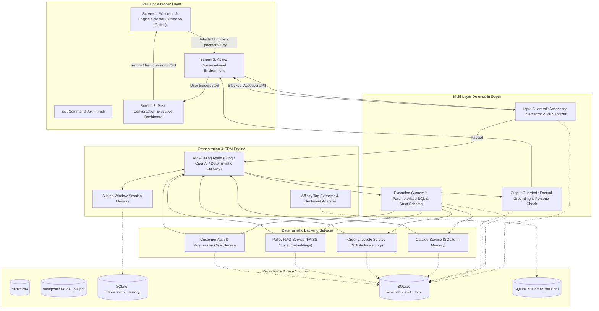

# TECHNICAL SPECIFICATION (SPEC-DRIVEN DEVELOPMENT)
## Autonomous Conversational AI Assistant & Telemetry Engine
**Project:** Empório da Música Conversational Retail Assistant  
**Author:** Manuel Portela Neto  
**Target Position:** AI Engineer – Full-Stack para Aplicações com IA Generativa (Artefact)  
**Target Repository:** `https://github.com/manuelportelaneto/emporio-musica-ai-agent.git`  
**Primary Language:** Python 3.10+  
**Documentation Language:** English  

---

## 1. Executive Summary & Business Scenario

### 1.1 Context
**Empório da Música** is a brick-and-mortar and digital musical instruments retailer founded in 2008 in Campo Grande/MS (Rua 14 de Maio, 3200). Operating for over 15 years, it sells acoustic and electric guitars, basses, drums, keyboards, wind instruments, orchestral strings, and ukuleles. 

The human customer support team is currently bottlenecked by high volumes of repetitive inquiries: store operating hours, live stock status, order tracking, returns, and payment options.

### 1.2 Core Business Directives & Boundary Constraints
1. **Strict Catalog Scope:** The store retails **musical instruments exclusively**. Per internal policy, it does **not** sell accessories (e.g., strings, cables, picks, pedals, amplifiers, gig bags, cases, or tuners). All accessory queries must be politely declined and redirected to partner stores in Campo Grande.
2. **Consultative Selling Tone:** Friendly, warm, musically knowledgeable ("fellow musician" persona), and transparent. The assistant invites customers to the Campo Grande store (Rua 14 de Maio, 3200) **contextually and subtly** (e.g., when the customer wants to feel the neck ergonomics, test acoustic resonance in person, or asks for physical address), strictly avoiding repetitive or intrusive canned sales invitations on generic searches.
3. **Progressive Profiling & Customer Identity:**
   - **Frictionless Initial Browsing:** Anonymous browsing of instruments, prices, and policies is permitted without forced login gates.
   - **Progressive Identification & Input Standardization (Phone & CPF):** When sensitive operations occur (checking order status, initiating returns, or saving personal preferences), the assistant requests the customer's **full Phone (`phone`)** or CPF. The assistant **strictly instructs the customer to send only integer digits without dots, commas, hyphens, or parentheses** (e.g. `67998123456` or `12345678900`) to anticipate data cleansing at the source, while internal services maintain automated normalization as an extra safety layer.
   - **Dynamic Account Resolution:** If the phone matches `customers`, the account is unlocked with full purchase history. If not found, a new customer record is created on the fly.
   - **Contextual In-Flow Data Collection:** Additional data (e.g., street address for localized motoboy delivery calculation) is requested naturally as the conversation requires it.
4. **Customer Affinity Profiling:** As the customer discusses instruments and musical styles, contextual keywords and interest tags (e.g., `["guitarra", "fender", "iniciante", "rock"]`) are captured and attached to the session context for tailored recommendations.
5. **Operational Policies Adherence:**
   - **Payment:** PIX (5% off on regular-priced items; non-cumulative with active promotions), Credit Card up to 12x interest-free (installments $\ge$ R$ 100 for 7–12x; $\ge$ R$ 80 for 4–6x; $\ge$ R$ 50 for up to 3x).
   - **Returns:** Statutory 7-day remorse return window starting from delivery date (Brazilian Consumer Defense Code - CDC); 30-day warranty for defects; mouthpieces, custom setups, and clearance items marked "final sale" are strictly non-refundable.
   - **Shipping:** Free local shipping in Greater Campo Grande for orders > R$ 500; flat fee of R$ 35 below R$ 500 (motoboy delivery in 1–3 business days). Out-of-state shipments handled via Correios (PAC/SEDEX) and Jadlog.

---

## 2. Engineering Methodology & Architectural Rationale

This project adheres strictly to **Spec-Driven Development (SDD)** with an **Architecture-First** methodology.



### 2.1 Trade-Off Analysis & Architectural Decisions

| Decision | Alternative Evaluated | Engineering Rationale & Business Objective |
| :--- | :--- | :--- |
| **Progressive Profiling via Phone** | Upfront Hard Auth Gate (Mandatory CPF/Password) | Requiring credentials upfront causes $>80\%$ bounce rates on e-commerce. Progressive profiling allows anonymous browsing, prompting for Full Phone only when contextualizing orders or saving records. |
| **Ephemeral In-Memory API Key Management** | Hardcoded or Stored `.env` Secrets | For evaluator ease and zero leak risk, evaluator API keys are accepted in memory at runtime, never persisted to disk, and wiped on program exit. |
| **Single Agent with Native Tool Calling** | Multi-Agent Hierarchy (Router + Worker Agent) | Multi-agent pipelines introduce dual LLM invocations for every turn, compounding latency ($+1200\text{ms}$) and doubling token costs. Native function calling (`bind_tools`) achieves deterministic sub-500ms execution with typed JSON schema validation. |
| **Deterministic Backend Tool Services** | Text-to-SQL Dynamic Generation | Free-form SQL generation by LLMs is vulnerable to prompt injection, schema hallucination, and Cartesian product overflows. Parameterized Python services guarantee security, consistency, and exact CDC remorse math. |
| **Dual-Layer Persistence + Session CRM** | Single consolidated log file | Decouples chat replay (`conversation_history`) from technical telemetry (`execution_audit_logs`) and customer session metrics (`customer_sessions`). |

---

## 3. Data Ingestion & Relational Schema Specifications

### 3.1 Raw Data Sources (`data/` Directory)
- `data/categories.csv`: Category hierarchy (Guitarras, Baixos, Violões, Teclados).
- `data/products.csv`: Instruments inventory, brands, specifications, prices, stock levels.
- `data/customers.csv`: Customer records, names, phones, emails, addresses.
- `data/orders.csv`: Order header data, status, tracking codes, delivery dates.
- `data/order_items.csv`: Order line items with historical unit prices.
- `data/promotions.csv`: Discount campaigns with start/end dates and active flags.
- `data/políticas_da_loja.pdf`: Internal customer service manual and operational rules.

### 3.2 In-Memory SQLite Schema

```sql
CREATE TABLE categories (
    category_id INTEGER PRIMARY KEY,
    name TEXT NOT NULL,
    description TEXT
);

CREATE TABLE products (
    product_id INTEGER PRIMARY KEY,
    name TEXT NOT NULL,
    category_id INTEGER REFERENCES categories(category_id),
    brand TEXT NOT NULL,
    price REAL NOT NULL,
    stock_quantity INTEGER NOT NULL,
    description TEXT
);

CREATE TABLE customers (
    customer_id INTEGER PRIMARY KEY AUTOINCREMENT,
    name TEXT NOT NULL,
    email TEXT,
    phone TEXT UNIQUE NOT NULL,
    birth_date TEXT,
    address TEXT,
    city TEXT,
    state TEXT,
    created_at TIMESTAMP DEFAULT CURRENT_TIMESTAMP
);

CREATE TABLE orders (
    order_id INTEGER PRIMARY KEY,
    customer_id INTEGER REFERENCES customers(customer_id),
    order_date TEXT NOT NULL,
    status TEXT NOT NULL,
    total_amount REAL NOT NULL,
    tracking_code TEXT,
    delivery_date TEXT
);

CREATE TABLE order_items (
    order_item_id INTEGER PRIMARY KEY,
    order_id INTEGER REFERENCES orders(order_id),
    product_id INTEGER REFERENCES products(product_id),
    quantity INTEGER NOT NULL,
    unit_price REAL NOT NULL
);

CREATE TABLE promotions (
    promotion_id INTEGER PRIMARY KEY,
    product_id INTEGER REFERENCES products(product_id),
    discount_percentage REAL NOT NULL,
    start_date TEXT,
    end_date TEXT,
    is_active INTEGER NOT NULL DEFAULT 1
);
```

### 3.3 Non-Structured Policy RAG Vector Store
- **Source:** `data/políticas_da_loja.pdf`
- **Chunking Strategy:** Recursive character splitting (chunk size: 400 characters, overlap: 60 characters).
- **Embedding / Vector Search:** Lightweight local TF-IDF semantic vector cosine index for instant, zero-dependency, reproducible retrieval.

---

## 4. Deterministic Backend Tool Contracts

### Tool 1: `lookup_catalog`
- **Parameters:** `query` (string), `category` (string), `max_price` (float), `in_stock_only` (bool).
- **Business Logic:** Relational lookup with 5% PIX non-cumulative discount and 12x/6x installment calculator. Limits output to Top 3.

### Tool 2: `get_order_details`
- **Parameters:** `order_id` (int), `customer_name_or_phone` (string).
- **Business Logic:** Returns order status, tracking, items, and CDC Art. 49 7-day remorse calculation.

### Tool 3: `query_store_policy`
- **Parameters:** `topic` (string).
- **Business Logic:** Semantic chunk retrieval from `políticas_da_loja.pdf` for shipping, hours, address, and warranty terms.

### Tool 4: `authenticate_or_register_customer`
- **Description:** Identifica e autentica um cliente existente pelo telefone completo ou cria um novo cadastro de forma transparente.
- **Parameters:**
  ```json
  {
    "phone": {"type": "string", "description": "Telefone completo do cliente com DDD (ex: '6799887766' ou '67 99988-7766')"},
    "name": {"type": "string", "description": "Nome completo do cliente"},
    "birth_date": {"type": "string", "description": "Data de nascimento opcional (ex: '15/04/1990')"}
  }
  ```
- **Business Logic:** Normalizes phone number digits. Searches `customers` table. If matched, returns customer ID, verified name, and recent orders. If not matched, inserts new customer record, binds to active session, and returns fresh customer profile.

### Tool 5: `update_customer_profile`
- **Description:** Atualiza dados cadastrais complementares (endereço ou preferências musicais) de forma fluida e contextual durante o atendimento.
- **Parameters:**
  ```json
  {
    "phone": {"type": "string", "description": "Telefone do cliente autenticado"},
    "address": {"type": "string", "description": "Novo endereço ou CEP para entrega"},
    "musical_interests": {"type": "array", "items": {"type": "string"}, "description": "Instrumentos ou marcas de interesse"}
  }
  ```
- **Business Logic:** Updates address and records customer preferences in relational database.

---

## 5. Multi-Layer Guardrails Specification

### 5.1 Layer 1: Input Guardrails
1. **Accessory Denial Interceptor (Zero-LLM Bypass):**
   - Matches keywords: *cordas, encordoamento, palheta, cabo, pedal, pedaleira, amplificador, caixa, case, bag, afinador, correia, suporte*.
   - Returns immediate polite refusal and points to central Campo Grande stores, consuming 0 tokens.
2. **PII Masking & Sanitization:**
   - Detects and masks Brazilian CPF patterns (`\d{3}\.\d{3}\.\d{3}-\d{2}`) and credit card numbers as `[CPF PROTEGIDO]` and `[CARTÃO PROTEGIDO]`.
3. **Prompt Injection & Off-Topic Jailbreak Guard:**
   - Detects prompt overrides and non-retail requests. Re-anchors dialogue to musical instruments.

### 5.2 Layer 2: Execution Guardrails
1. **Read-Only SQLite Pragma:** Analytical queries run under `PRAGMA query_only = ON;`.
2. **Strict Limit Enforcement:** Catalog queries enforce `LIMIT 3` to prevent context explosion.

### 5.3 Layer 3: Output Guardrails
1. **Factual Grounding Cross-Check:** Verifies that quoted prices and product models match the exact tool payload.
2. **Commercial Tone Modulator:** Ensures consultative warmth and strictly limits physical store invitations to natural conversational moments.

---

## 6. Persistence, Telemetry & CRM Schema

```sql
-- 1. Conversational History
CREATE TABLE IF NOT EXISTS conversation_history (
    id INTEGER PRIMARY KEY AUTOINCREMENT,
    session_id TEXT NOT NULL,
    role TEXT CHECK(role IN ('user', 'assistant', 'system')) NOT NULL,
    content TEXT NOT NULL,
    created_at TIMESTAMP DEFAULT CURRENT_TIMESTAMP
);

-- 2. Execution Audit & Telemetry Log
CREATE TABLE IF NOT EXISTS execution_audit_logs (
    id INTEGER PRIMARY KEY AUTOINCREMENT,
    session_id TEXT NOT NULL,
    event_type TEXT NOT NULL, -- 'TOOL_INVOCATION', 'GUARDRAIL_INTERCEPT', 'AGENT_RESPONSE', 'ERROR'
    component_name TEXT NOT NULL,
    input_payload TEXT,
    output_payload TEXT,
    latency_ms REAL NOT NULL,
    prompt_tokens INTEGER DEFAULT 0,
    completion_tokens INTEGER DEFAULT 0,
    status TEXT NOT NULL,
    created_at TIMESTAMP DEFAULT CURRENT_TIMESTAMP
);

-- 3. Customer Session Summary & Analytics CRM
CREATE TABLE IF NOT EXISTS customer_sessions (
    session_id TEXT PRIMARY KEY,
    customer_id INTEGER REFERENCES customers(customer_id),
    phone TEXT,
    customer_name TEXT,
    affinity_tags TEXT, -- JSON array: e.g. ["violão", "yamaha", "iniciante"]
    sentiment_score TEXT, -- 'Positivo', 'Neutro', 'Frustrado', 'Curioso / Entusiasmado'
    interaction_category TEXT, -- 'Consulta Catálogo', 'Pós-Venda / Rastreio', 'Troca / Devolução', 'Fora de Escopo'
    alerts_detected TEXT, -- JSON array of multi-scope alerts
    total_duration_sec INTEGER DEFAULT 0,
    created_at TIMESTAMP DEFAULT CURRENT_TIMESTAMP
);
```

---

## 7. Evaluator Wrapper & Interactive Lifecycle Experience

To provide a professional experience for technical evaluators, the application is wrapped in an interactive 3-stage lifecycle.

### 7.0 Language Architecture & Segregation Rule
* **Evaluator Interface (English Mandatory):** All evaluator-facing screens, setup prompts, tables, dashboards, alerts, metrics, and menus MUST be strictly in **English**.
* **Retail Conversational Window (Portuguese PT-BR):** Customer-facing dialogue turns (user questions and assistant consultative responses) operate in **Portuguese**, reflecting the Brazilian physical and digital retail context of Campo Grande/MS.

---

### 7.1 Screen 1: Welcome & Engine Configuration (Onboarding)
* **Executive Intro:** Project overview (Empório da Música Conversational AI Assistant – Artefact Technical Case).
* **Engine Selection:**
  * `[1] Deterministic Offline Engine (Default)`: Zero-cost, sub-20ms latency, deterministic tool routing, 100% stable without external dependencies.
  * `[2] Online LLM (Groq / OpenAI)`:
    - Evaluator selects provider and model (e.g., `llama-3.3-70b-versatile` or `gpt-4o-mini`).
    - Secure masked API key prompt (`getpass`).
    - **Ephemeral Security Guarantee:** API keys remain strictly in-memory during execution, are never written to disk or logs, and are wiped immediately upon exiting.
* **Interface Target Selection:**
  * `[1] Continue in Terminal CLI (Interactive Rich Terminal)`
  * `[2] Launch in Browser with Streamlit Web App (Visual UI)`

---

### 7.2 Screen 2: Active Conversational Environment
* Interactive Rich chat terminal with live Telemetry HUD displayed after every turn (strictly text-based, no emojis in UI frame):
  ```text
  ┌─ [TELEMETRY & AUDIT HUD] ───────────────────────────────────────────────────────┐
  │ [RESPONSE TIME] 18ms  |  [TOKENS] 210 (Prompt: 135 / Completion: 75)            │
  │ [TOOL INVOKED] lookup_catalog(query="Yamaha C40", in_stock_only=True)          │
  │ [GUARDRAILS] Scope Passed | Factual Grounding: 100% Verified                  │
  └────────────────────────────────────────────────────────────────────────────────┘
  ```
* Exit command: `/exit`, `/finish`, or `/quit` immediately closes the chat turn and transitions to the post-conversation analytics dashboard.

---

### 7.3 Screen 3: Post-Conversation Executive Analytics & Insights Dashboard
Rendered as an English Rich formatted executive report displaying:
1. **Session Performance Metrics:**
   - Total conversation duration (e.g., `1m 42s`).
   - Average agent response time / latency (e.g., `24.5 ms`).
   - Total tokens consumed & average tokens per turn.
   - Ranking of tools and actions invoked.
2. **Customer Intelligence & CRM Profile:**
   - Registration status: `Registered (ID #X - Name)` vs `Guest / Unregistered`.
   - Customer Sentiment Assessment: *Positive*, *Neutral*, *Frustrated*, *Curious / Enthusiastic*.
   - Inferred Musical Affinity Tags: e.g., `["violão", "yamaha", "iniciante"]`.
3. **Multi-Scope System Alerts & Insights:**
   - **Development Scope (System Improvements):** Ambiguous queries detected, search fallbacks triggered, or latency spikes.
   - **Security Scope (Security & Compliance):** Prompt injection attempts, jailbreak attempts, or masked PII occurrences.
   - **Business Scope (Business Opportunities):** Products searched that are out-of-stock or non-catalog (e.g., unmet demand for accessories or unstocked brands).
4. **Historical Sessions & Interaction Browser:**
   - Displays all historical customer sessions saved in SQLite (`conversation_history`), allowing evaluators to review previous conversation transcripts across distinct sessions.
5. **Evaluator Action Menu:**
   - `[1] Return to current conversation` (resume chat session)
   - `[2] Start a new conversation` (reset session for a new clean run)
   - `[3] View all saved interactions (Audit log & historical sessions)`
   - `[4] Exit program` (clean memory wipe and shutdown)

---

### 7.4 Streamlit Web Application Implementation Plan

To provide a visual web experience complementing the CLI, a dedicated Streamlit web application (`app.py`) will be implemented following the CLI evaluator layer:

1. **Architecture & File Layout:**
   - `app.py`: Streamlit main entrypoint importing `ConversationalOrchestrator` and `AuditStore`.
   - Reuses the identical backend services, guardrails, and SQLite data engine.
2. **Left Control Sidebar:**
   - **Engine Mode Selector:** Radio toggle between *Deterministic Offline Engine* and *Online LLM (Groq / OpenAI)*.
   - **Ephemeral API Key Input:** Masked text input (`type="password"`) stored strictly in `st.session_state` (never written to disk).
   - **Active Session ID:** Input box to switch or start new isolated sessions (`/session`).
   - **Cumulative Telemetry Card:** Live widget displaying total session events, total tokens, average response time, and tools invoked.
3. **Main Workspace (Tabbed Interface):**
   - **Tab 1: Live Chat Console:**
     - Streamlit chat message bubbles (`st.chat_message("user")` and `st.chat_message("assistant")`).
     - Real-Time Observability HUD rendered under each assistant response in a monospace block.
   - **Tab 2: Executive Analytics & Telemetry:**
     - Bar chart of tools invoked (`st.bar_chart`).
     - Latency timeline and token consumption gauges.
   - **Tab 3: Customer Intelligence & 3-Scope Alerts:**
     - Customer CRM card (phone, name, address, registration status).
     - Customer sentiment indicator pill.
     - Musical affinity tags chips (`st.pills` / badges).
     - Multi-scope expandable alert containers (Development, Security, Business).
   - **Tab 4: Historical Sessions Explorer:**
     - Dropdown to select and inspect any prior conversation stored in `emporio_records.db`.
     - Full conversational transcript viewer and raw audit telemetry event stream.
4. **Implementation Status:**
   - **Phase 1: CLI Evaluator Layer (`src/cli.py`):** Completed and verified with onboarding, active chat with HUD, executive post-conversation dashboard, and historical sessions browser.
   - **Phase 2: Streamlit Web Application (`app.py`):** Completed and verified with ephemeral key management, 4-tab dashboard, live chat with HUD, analytics charts, CRM intelligence, and historical audit browser.

---

## 8. Future Production Improvements Roadmap

1. **Hybrid Retrieval (Dense + BM25 Lexical):** Combine vector embeddings with BM25 sparse keyword ranking to enhance precision for complex alphanumeric product codes (e.g., "GD20-NS", "PACIFICA112V").
2. **Distributed Tracing & Evals Integration:** Connect telemetry logs to OpenTelemetry, Langfuse, or Arize Phoenix to track latency percentiles ($p_{95}, p_{99}$), prompt drift, and token expenditures across deployments.
3. **Automated CI/CD RAG Evaluations:** Implement continuous evaluation pipelines with Ragas / TruLens running automated regression tests measuring Context Relevancy, Faithfulness, and Answer Correctness on each release.
4. **WhatsApp Business Cloud API Connector:** Wrap the orchestrator in an asynchronous FastAPI service interfacing with official Meta Cloud API webhooks for production rollout.
5. **Human-in-the-Loop (HITL) Handoff Console:** Provide a support dashboard enabling human attendants at the Campo Grande storefront to claim conversations and review the audit log in real time.